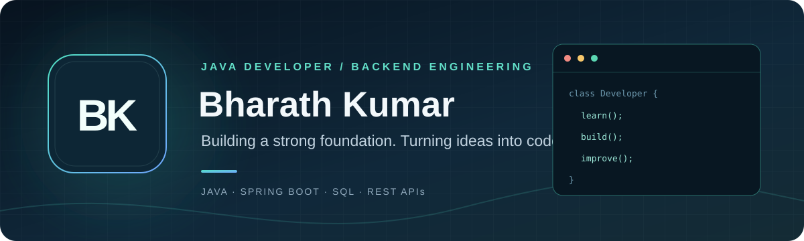
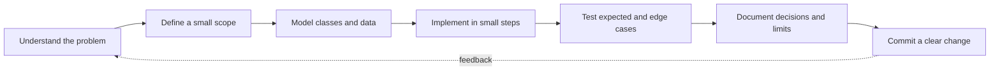

<!-- Profile overview: Bharath Kumar -->

### Java Developer · Backend Engineering · Full-Stack Foundations

I turn concepts into small, understandable software — then improve it with **clear design, careful testing, and honest documentation**.

[LinkedIn](https://www.linkedin.com/in/bharath-kumar-181316296/) · [Email](mailto:parakandlabharath@gmail.com) · [GitHub](https://github.com/parakandlabharath)

---

## A little about me

I'm a Computer Science graduate focused on Java and backend development. I enjoy understanding how an application works end to end: from the problem and data model to APIs, persistence, and the user experience.

- **Education:** B.Tech in Computer Science and Engineering — K K R & K S R Institute of Technology and Sciences, 2026
- **Currently strengthening:** Core Java, SQL, Spring Boot, REST API development, and problem solving
- **Interested in:** Object-oriented design, databases, system design, and dependable software
- **Career goal:** Entry-level Java Developer / Full-Stack Developer

## My engineering toolkit

| Focus | Technologies and concepts |
|---|---|
| Languages | Java · JavaScript · C++ |
| Backend | Spring Boot · REST APIs · Spring Data JPA |
| Frontend | HTML · CSS · JavaScript |
| Data | SQL · MySQL |
| Core concepts | OOP · Collections · Exception Handling · DSA |
| Workflow | Git · GitHub · GitHub Actions · VS Code · Eclipse |

This is my learning and working toolkit, not a claim that every technology is used in every project.

## Featured work

> I prefer showing the real stage of a project over calling every repository “完成” or production-ready. Each project README describes what exists and what is still planned.

### 01 · [Mana Suraksha](https://github.com/parakandlabharath/Mana-Suraksha)
**Digital-fraud awareness and protection prototype** · Java / Spring Boot

Explores explainable checks for suspicious SMS text, URL structure, and phone-number formats. The repository includes a starter API and web interface. It is an early prototype — not a production fraud-detection service.

### 02 · [Java Basics Practice](https://github.com/parakandlabharath/Java-Basics-Practice)
**Core Java learning lab** · Java 17

Organized examples for Java fundamentals, OOP, packages, and collections, plus a console-based Employee Management mini-project and a Java 17 compilation workflow.

### 03 · [Java Interface Addition](https://github.com/parakandlabharath/Java-Interface-Addition)
**Small, focused Java exercise**

Demonstrates an `Addition` interface with separate integer and long implementations.

### 04 · [Online Price Tracker](https://github.com/parakandlabharath/Online-price-tracking)
**Price monitoring concept** · Planning stage

A project space for tracking product prices, target prices, and price history. Application source and verified run instructions are still to be added.

### 05 · [Code Quest](https://github.com/parakandlabharath/Code-Quest)
**Team task-management concept** · Planning stage

A planned Kanban-style workflow for organizing work across To Do, In Progress, and Done. See the repository for its current scope.

## How I approach a feature

I use a repeatable build loop to keep projects understandable and small enough to validate:

**My rule:** make the smallest useful version work before adding complexity.

## What I'm working to improve

- [x] Practise Java fundamentals with small programs
- [x] Work with OOP, interfaces, and collections
- [ ] Build stronger Core Java interview fundamentals
- [ ] Progress from SQL basics to advanced queries
- [ ] Build and test REST APIs with Spring Boot
- [ ] Add persistence, validation, and automated tests to project work
- [ ] Practise DSA and system design consistently

## Find me

- **LinkedIn:** [bharath-kumar-181316296](https://www.linkedin.com/in/bharath-kumar-181316296/)
- **Email:** [parakandlabharath@gmail.com](mailto:parakandlabharath@gmail.com)
- **GitHub:** [@parakandlabharath](https://github.com/parakandlabharath)

---

*Learn deliberately. Build honestly. Improve continuously.*

